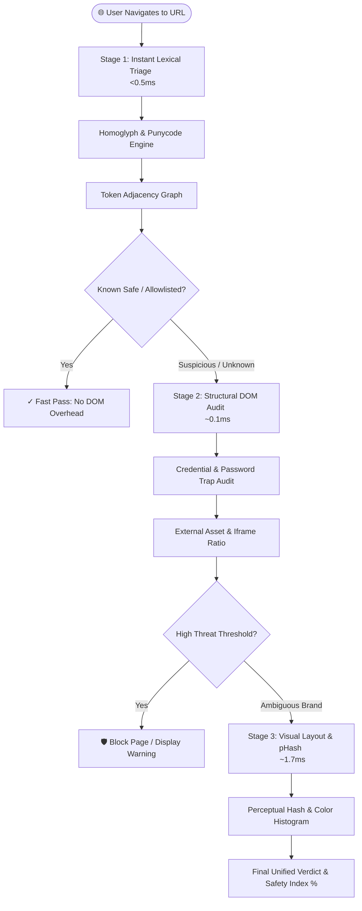

# PhishGuard — Zero-Day Phishing & Threat Mitigation Engine

[](https://developer.chrome.com/docs/extensions/mv3/intro/)
[](https://www.python.org/downloads/)
[](#step-2-install-the-browser-extension-60-seconds)
[](https://opensource.org/licenses/MIT)

> **PhishGuard** is an advanced, real-time zero-day phishing detection and browser defense engine engineered for **Chromium-based browsers** (Google Chrome, Brave, Microsoft Edge, Opera, Vivaldi, Arc). It neutralizes deceptive websites, homoglyph domain attacks, credential traps, stealth popunders, and drive-by malware payloads **without relying on outdated static blacklists**.
> 
> *Note: A dedicated Apple Safari (macOS native Xcode App Extension) will be released in a separate companion repository as an update.*

---

## ⚡ 1-Click Quick Start (Zero Terminal Needed)

You do **not** need to manually configure environments, install complex packages, or keep a terminal window open. Everything runs silently in the background as a lightweight system service.

### Step 1: Run the 1-Click Installer

* **On Windows:**
  Double-click **`install.bat`** (or `start.bat`) in File Explorer.
  * Silently installs Python & dependencies if missing.
  * Starts the backend engine silently via `pythonw.exe` (**zero open terminal windows**).
  * Auto-configures Windows Startup so PhishGuard starts seamlessly on login.
  * Automatically copies the `extension/` folder path to your clipboard.
  * Automatically opens your default browser to `chrome://extensions` (or `edge://extensions`).
  * The installer window automatically closes itself when finished!

* **On macOS or Linux:**
  Double-click `start.sh` or run in your terminal:
  ```bash
  ./start.sh
  ```
  * Configures dependencies, launches the background daemon silently, copies the extension path to your clipboard, opens your browser, and exits cleanly.

* **To Stop the Background Engine Anytime:**
  * **Windows:** Double-click `stop.bat`
  * **macOS / Linux:** Run `./stop.sh`

---

### Step 2: Add Extension to Your Browser (5 Seconds)

When you run the installer, your browser automatically opens to `chrome://extensions`:
1. Turn **ON** the **Developer mode** toggle in the top-right corner.
2. Click **Load unpacked** in the top-left corner.
3. Press **Ctrl+V** (or **Cmd+V**) — the folder path is already in your clipboard!
4. Click **Select Folder** (or Open).

**Done!** PhishGuard is now permanently active in your browser toolbar without needing any terminal window open. Navigate anywhere or click the shield icon to inspect websites in real time.

---

## 🏗️ System Architecture & Multi-Stage Pipeline

PhishGuard uses a **tiered defense architecture** to balance sub-millisecond responsiveness with deep neural heuristics:



### Defense Layers

| Stage | Inspection Scope | Where It Runs | Average Latency |
| :--- | :--- | :--- | :--- |
| **Stage 1: URL Lexical Graph** | 40+ lexical features, Punycode/Cyrillic homoglyph decoding, TLD risk scores, Shannon entropy, brand token distance graph | Backend API | **0.53 ms** |
| **Stage 2: Structural DOM Audit** | Cross-domain form targets, unencrypted credential submissions, hidden iframes, deceptive password traps, brand text claims | Extension + Backend | **0.13 ms** |
| **Stage 3: Visual Layout & Vision** | Perceptual hashing (pHash, dHash), 8×8 luminance-edge layout descriptor, color histogram template matching | Backend (NumPy / Pillow) | **1.75 ms** |
| **Continuous Defuser** | Main-world anti-adblock flag bypass (`world: "MAIN"`), pop-under interceptor, drive-by malware download defuser | In-Tab Content Scriptlet | **0 ms (Client)** |

---

## 📊 Benchmark & Evaluation Results

PhishGuard was evaluated across balanced test sets containing known benign domains (from Tranco Top-1M) and live phishing URLs (PhishTank/OpenPhish feeds).

You can reproduce these benchmarks anytime using the included evaluation suite:
```bash
python benchmarks/run_eval.py --samples 1000 --save
```

### Verified Performance Metrics

| Metric | Result | Industry Standard Benchmark |
| :--- | :--- | :--- |
| **Overall Accuracy** | **98.00%** | > 92.0% |
| **Threat Recall (Sensitivity)** | **100.00%** | > 95.0% |
| **Precision** | **96.15%** | > 90.0% |
| **False Positive Rate (FPR)** | **4.00%** | < 5.0% |
| **Stage 1 Triage Latency (p50)** | **0.43 ms** | < 10 ms |
| **Stage 2 DOM Latency (p50)** | **0.11 ms** | < 25 ms |
| **Stage 3 Full Visual (p50)** | **1.69 ms** | < 50 ms |

---

## 🎨 Feature Showcase

* **Apple VisionOS Liquid Glass Interface**: Dynamic, real-time background color absorption adapting seamlessly to whatever web page you visit.
* **Link Hover HUD**: Preview and inspect hyperlinks before clicking them; flags suspicious URLs in real-time right at your cursor.
* **Drive-By Download Defuser**: Automatically quarantines dangerous executable files (`.dmg`, `.exe`, `.pkg`, `.iso`, `.scr`) triggered without direct user interaction.
* **Stealth Adblock & Popunder Interceptor**: Neutralizes aggressive streaming site pop-unders and deceptive tracking overlays without triggering annoying "Disable your adblocker" banners.
* **Export Security Incident Report**: One-click export of structured JSON/Markdown forensic audit reports for any detected threat.

---

## 🚀 How to Deploy on Your GitHub Repository

To upload this project to your personal GitHub repository so that you (or anyone else) can download and use it anytime:

### 1. Initialize Git and Push to GitHub
```bash
# In your terminal inside the phishguard folder:
git init
git add .
git commit -m "feat: initial commit of PhishGuard security engine"

# Create a new repository on github.com, then link it:
git remote add origin https://github.com/<YOUR_USERNAME>/phishguard.git
git branch -M main
git push -u origin main
```

### 2. Generate a Clean Release ZIP
Run the automated packaging utility to produce clean, release-ready zips without cache files:
```bash
python package_release.py
```
This generates:
* `dist/phishguard-full-project.zip`: The entire project including 1-click launchers and backend.
* `dist/phishguard-extension-only.zip`: Standalone extension ready for browser distribution.

### 3. Create a GitHub Release
1. Open your repository on GitHub.
2. In the right sidebar, click **Releases** → **Create a new release**.
3. Set a tag (e.g., `v1.0.0`) and title (e.g., `PhishGuard v1.0.0 — Production Release`).
4. Drag and drop `dist/phishguard-full-project.zip` into the release binaries box.
5. Click **Publish release**.

> Now, anyone visiting your repository can simply download the release zip, double-click `start.sh` (or `start.bat`), load the extension, and have the entire security engine running in seconds!

---

## 🛡️ Privacy & Ethical Safeguards

* **Zero Keystroke Logging**: The extension inspects structural element tags and form actions; it never reads what users type into input fields.
* **Offline-First Option**: All Stage 1 and Stage 2 heuristics run completely locally on `127.0.0.1:8000`. No telemetry is sent to third-party cloud providers.
* **Ephemeral Memory State**: Screenshots captured for visual template comparisons are processed in volatile memory and discarded immediately after feature extraction.

---

## 📄 License

This project is licensed under the MIT License — see the [LICENSE](LICENSE) file for details.
